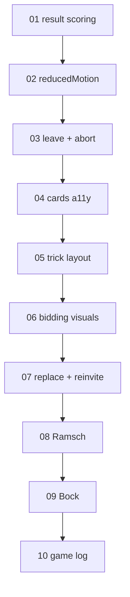

# Planned changes: implementation plans

This folder turns the user's request in `planned-changes.md` (repository root) into ten
self-contained plans. Each plan can be implemented by a smaller model **on its own**, one after
the other, in the order below. When a plan is done, its file stays here as a record; the
`docs/*.md` layer docs describe the new current state.

**Status:** plans 01–08 are implemented. Plans 09–10 are still open. The
"Lines now" and "baseline" figures below are from before plan 01 and are kept as a record.

## 1. Order (do not reorder)

| # | Plan | Kind | Layers touched | Protocol change |
|---|---|---|---|---|
| 01 | `01-result-dialog-scoring.md`: result dialog follows the Seeger/standard setting; default scoring = standard | bug fix | ui | no |
| 02 | `02-remove-reduced-motion.md`: delete the unused `reducedMotion` setting | bug fix | ui | no |
| 03 | `03-send-leave-and-abort.md`: Leave sends `leave`; host can send `abort-game`; leavers are removed at the next deal | bug fix | table, net, ui | no |
| 04 | `04-card-a11y-preload-texts.md`: illegal cards as disabled buttons with `aria-disabled`, preload card images, remove unused texts | bug fix | ui, e2e | no |
| 05 | `05-trick-layout.md`: trick cards at fixed positions (left / right / own card bottom center, triangle) | feature | ui | no |
| 06 | `06-bidding-visualization.md`: speech bubbles, last bid only, bubble duration setting, declarer summary line | feature | ui | no |
| 07 | `07-reconnect-replace-reinvite.md`: replace a seat mid-game (pending player or bot), Players dialog, invite codes/links | feature | table, net, ui, e2e | **yes → 4** |
| 08 | `08-ramsch.md`: table rule "Ramsch when everybody passes" | feature | docs/rules, engine, table, bots, net, ui | **yes → 5** |
| 09 | `09-bockrunden.md`: table rule "Bockrunden" (60:60 → next 3 games double) | feature | docs/rules, table, net, ui | **yes → 6** |
| 10 | `10-game-log.md`: game log dialog from the top bar | feature | table, net, ui | **yes → 7** |

Why this order (it differs from the order in `planned-changes.md`):

- Bug fixes first, as the user asked.
- UI-only features (05, 06) next: no protocol change, low risk.
- 07 before 08/09: it introduces the "Players" dialog and the file splits (`host.ts`, i18n) that
  later plans rely on.
- 08 introduces the table rules object (`TableRules`, command `set-rules`); 09 only adds a field.
- 10 last, so that the log can cover every event kind (replacements, Ramsch, Bock) in one place.

## 2. Rules for every plan (read once, apply always)

1. **Start**: read root `AGENTS.md`, `docs/dev/workflow.md`, and the "Read first" list at the top of
   the plan. `git --no-optional-locks status` must show no unexpected changes. Run `npm run check`
   and make sure it is green **before** you change anything (baseline: 51 files, 592 tests).
2. **One plan at a time.** Finish it completely (code, tests, docs, `npm run check` green, e2e if the
   plan says so) before starting the next plan. Do not commit unless the user asks.
3. **Tests first** in the lowest layer (`docs/dev/testing.md`): write the test, see it fail
   (`npx vitest run path/to/file.test.ts`), then implement.
4. **Hard rules** (`AGENTS.md` §3) always apply: pure `src/engine`/`src/table`, no `any`,
   no `@ts-ignore`, no eslint-disable, exhaustive `switch` with `assertNever`, `Result` instead of
   throwing, zod for network and storage data, every visible text through `t()` with keys in
   **both** `en.ts` and `de.ts`, files < 300 lines, no new dependencies.
5. **File size watch list.** These files are already close to 300 lines. The plans say where new
   code goes; never push one of them over 300 lines:

   | File | Lines now | Plans that touch it | What to do |
   |---|---|---|---|
   | `src/engine/game.ts` | 290 | 08 | 08 moves `Legal`/`getLegal`/`enumerateActions` to `legal.ts` first |
   | `src/net/host.ts` | 265 | 07, 10 | 07 moves peer bookkeeping and invites into new files first |
   | `src/table/table.ts` | 251 | 03, 07, 08, 09, 10 | new commands live in new files (`replace.ts`, `rules.ts`, `bock.ts`, `log.ts`) |
   | `src/ui/i18n/en.ts`, `de.ts` | 272 / 270 | all | 06 splits the dictionaries into parts first |
   | `src/ui/game/GameScreen.tsx` | 246 | 01, 03, 05, 06, 08, 09 | 05 extracts `TableCenter.tsx`, 06 extracts `StatusArea.tsx` |
   | `src/table/table.test.ts` | 239 | 03, 07, 08, 09, 10 | new tests go into new test files |

   Check with `wc -l <file>` after each step.
6. **Protocol version ledger.** `PROTOCOL_VERSION` (`src/net/constants.ts`) is 3 today. Plans 07,
   08, 09 and 10 each bump it by one (expected values 4, 5, 6, 7). Always bump from the value you
   find in the file, and add the line to the version history in `docs/networking.md` §1.
7. **Host snapshots.** Every change of the `TableState` or `HostSnapshot` shape needs a migration in
   `src/ui/persist/hosted.ts` (plan 07 moves migrations into `hostedMigrate.ts`) and a test in
   `hosted.test.ts`. Optional fields (`?:`) that mean "absent = default" need no migration.
8. **Client record caches.** `GameRecordSchema` (`src/net/schemaView.ts`) also validates the
   cached records in `localStorage`. New `GameRecord` fields need `.default(...)` in the schema so
   old caches still load.
9. **Decisions.** Each plan lists the decisions it implements. Append each as a new row to
   `docs/decisions.md` ("Decided during implementation") with the **next free `I` number** (the
   last one is I124 after plan 06). Copy the suggested text and adapt it to what you actually did.
10. **Docs.** Each plan lists the docs to update. Also run the checklist in
    `docs/dev/docs-maintenance.md` §3 (file maps in folder `AGENTS.md`, test ids in
    `docs/dev/e2e.md` §6, test inventory in `docs/dev/testing.md` §4, `docs/overview.md` §2/§3/§4).
11. **Finish**: `npm run check` green; run the e2e specs the plan names
    (`npx playwright test e2e/<spec>.ts`; see `docs/dev/e2e.md` §1 for the environment). Report
    what changed, which files, which checks ran with which result, and what was not verified.
12. If something in a plan does not match the code you find (line numbers drift, a helper was
    renamed by an earlier plan), trust the code, keep the plan's intent, and note the deviation in
    the decision row.

## 3. Conventions used in the plans

- Paths are relative to the repository root. "→" means "then".
- Code blocks show **shapes and intent**, not always final code. Follow the existing style of the
  file you edit (imports, readonly fields, small functions, comments only for non-obvious intent).
- "Test:" items list the test cases to write first. "Run:" items are the commands to run.
- i18n entries are given as `key`: English / German.
- Test ids (`data-testid`) are kebab-case and must be added to `docs/dev/e2e.md` §6.
