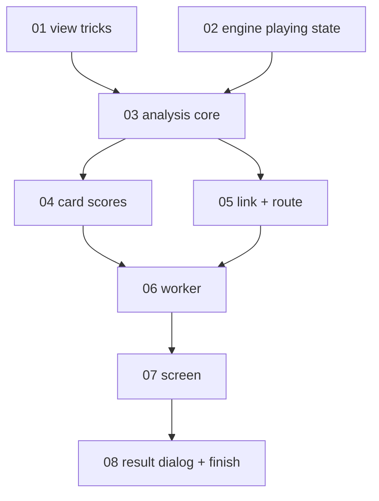

# Game analysis view: implementation plan

**Status:** implemented (steps 01–08). The current state is in `docs/ui.md` §11, `docs/table.md` §6a and `docs/decisions.md` I180–I187.

The user's request: the result dialog gets a game **analysis** that replaces the "Show all cards"
button and opens in a **new browser tab**. In the analysis you can

- see the starting cards of every player and the Skat,
- replay the card play step by step,
- see a **score for every playable card** of the player to move, computed by sampling many play-outs.
  The real distribution of the hidden cards is used only **optionally** (a switch). Sampling runs
  **continuously** for the current position and keeps improving the scores,
- try **variants**: play a different card than the one actually played and continue from there.

This folder splits the work into eight steps. Each step is self-contained and small enough for a
smaller model. Do them **in order**; each step ends with a green `npm run check`.

## 1. Order (do not reorder)

| # | File | What | Layers | Protocol change |
|---|---|---|---|---|
| 01 | `01-view-tricks.md` | Finished games show every trick in the view (`GameView.tricks`) | table, net | **yes → 11** |
| 02 | `02-engine-playing-state.md` | `playingStateFrom(setup)`: a `GameState` at the start of card play from known cards | engine | no |
| 03 | `03-analysis-core.md` | `src/table/analysis/`: `AnalysisInput`, `analysisInputFromView`, replay lines and positions | table | no |
| 04 | `04-card-scores.md` | Monte-Carlo card scores (`scoreBatch`), optional real hands, rollout policy | table (bot) | no |
| 05 | `05-link-and-route.md` | Encode the game into the URL (`#/analysis?g=…`), zod schema, route, lazy screen stub | ui | no |
| 06 | `06-worker.md` | Web Worker that samples continuously; `useCardScores` hook | ui | no |
| 07 | `07-analysis-screen.md` | The analysis screen: deal overview, replay board, controls, score list, variants | ui | no |
| 08 | `08-result-dialog-and-finish.md` | "Analyze game" button replaces "Show all cards", e2e, docs, changelog | ui, e2e, docs | no |



## 2. Architecture of the feature (read once)

```
Result dialog (ui)                 new tab: #/analysis?g=<base64url JSON>
  analysisInputFromView(view)  ──► AnalysisScreen (ui)
  (table, pure)                      decodeAnalysis → AnalysisInput (zod)
                                     analysisStart / positionAt   (table, pure)  → Position
                                     useCardScores ─► Web Worker (ui)
                                                        createRunner → scoreBatch (table, pure)
                                                                      → sampleDeal / simPlay / playOut (table/bot)
```

- **No network and no storage.** The whole finished game travels in the URL hash. The new tab
  loads the app, the route `#/analysis` reads the hash, validates it with zod, and works offline.
- **All game logic stays pure** (`AGENTS.md` hard rules 1 and 2). Legal cards, the replay, the
  trick winner, the result and the card scores come from `src/engine` / `src/table`. The UI only
  renders `Position.playable` and the stats it gets.
- **Hidden information:** a finished game already reveals every dealt hand to everybody
  (`docs/hidden-information.md` §2). Step 01 adds the order of the played cards for finished games
  only, which reveals nothing new. Nothing of a running game is ever put into the analysis.
- **The sampler is the Strong bot's PIMC machinery** (`docs/bots.md` §6): `sampleDeal` (hidden
  cards consistent with what the player to move knows), `simPlay`, `playOut` with the heuristic
  player. The analysis adds a slightly random rollout policy so that more samples keep improving
  the estimate in both modes (see step 04).

## 3. Decisions this plan takes (log them in `docs/decisions.md`)

The last decision row today is **I178**. Use the next free numbers when you implement; the step
files say which row to add. Suggested texts:

| Step | Decision | Text (adapt to what you did) |
|---|---|---|
| 01 | Finished views carry every trick | `GameView.tricks`: all completed tricks (leader, plays, winner) for everybody once the game is finished, `null` while it runs. The dealt hands are public then anyway; the order of play is needed for the replay. Protocol 11 |
| 02 | Card play can start from known cards | `playingStateFrom(setup)` in the engine builds the `GameState` at the first card of a played game or a Ramsch from the dealt hands, Skat, discard and declaration (no seed, no bidding replay). It validates the deck and the declaration and returns `Result`, reusing existing error codes |
| 03/07 | Replay scope | The analysis replays only the card play. Bidding, Skat pickup, discard, declaration and Kontra/Re are shown as static information. Variants change only played cards. A variant line keeps the actual game's later cards only while it agrees with them |
| 04 | Card scores | For every playable card: share of play-outs the mover's team wins and their average card points. Default: hidden cards are sampled from what the mover knows (own hand, played cards, shown voids, ouvert hand, own discard). Switch "Use the real cards": every play-out uses the real hands. Rollouts use the Normal heuristic with a 10 % chance of a random legal card per move, so both modes keep improving with more samples. "Won" uses card points and announced Schneider/Schwarz/ouvert; overbidding is ignored. Ramsch and passed-in games get no scores |
| 05 | Analysis link | The finished game is encoded as base64url JSON in `#/analysis?g=…` and opened with `window.open(..., '_blank', 'noopener')`. No storage, no network; the link can be bookmarked. The data is zod-validated and replayed by the engine before anything is shown |
| 06 | Continuous sampling | A module Web Worker runs `scoreBatch` in batches (8 samples per card), posts the summed stats after each batch, and stops at 3000 samples per card. A new position restarts it; pause/resume keeps the stats of the same position |
| 08 | "Show all cards" removed | The result dialog's "Show all cards" toggle is replaced by "Analyze game"; the dealt hands and the Skat are shown at the top of the analysis |

## 4. Rules for every step

1. Start: read the root `AGENTS.md`, `docs/dev/workflow.md`, and the "Read first" list of the step.
   `git --no-optional-locks status` must show only the changes of earlier steps. Run
   `npm run check` and make sure it is green **before** you change anything.
2. **One step at a time.** Finish it completely (code, tests, docs listed in the step, `npm run check`
   green) before starting the next. Do not commit unless the user asks.
3. **Tests first** in the lowest layer (`docs/dev/testing.md`): write the test, see it fail
   (`npx vitest run path/to/file.test.ts`), then implement.
4. **Hard rules** (`AGENTS.md` §3): pure `src/engine` / `src/table` (no `Math.random`, `Date`,
   `setTimeout`, `crypto`, DOM); no `any`, no `@ts-ignore`, no eslint-disable; exhaustive
   `switch` with `assertNever`; `Result` instead of throwing; zod for external data; every visible
   text through `t()` with keys in **both** languages; files < 300 lines; **no new dependencies**.
5. If the code differs from what a step describes (a name changed, a line moved), trust the code,
   keep the step's intent, and mention the deviation in the decision row.
6. Code blocks show **shapes and intent**. Follow the style of the file you edit (readonly fields,
   small functions, a one-line header comment per file, comments only for non-obvious intent).
7. i18n entries are given as `key`: English / German. Test ids are kebab-case and go into
   `docs/dev/e2e.md` §6.
8. **Changelog:** one entry under `## [Unreleased]` in `CHANGELOG.md` for the whole feature is
   written in step 08. Steps 01–07 may leave it out; never bump the version.
9. Finish each step by reporting what changed, which files, which checks ran with which result.

## 5. New files at a glance

| File | Step | Contents |
|---|---|---|
| `src/engine/playingState.ts` (+ test) | 02 | `PlaySetup`, `playingStateFrom` |
| `src/table/analysis/types.ts` | 03 | `AnalysisKind`, `AnalysisBid`, `AnalysisInput`, `AnalysisLine`, `Position` |
| `src/table/analysis/fromView.ts` (+ test) | 03 | `analysisInputFromView(view)` |
| `src/table/analysis/replay.ts` (+ test) | 03 | `analysisStart`, `positionAt`, `chooseCard`, `divergenceAt`, `actualLine` |
| `src/table/analysis/scores.ts` (+ test) | 04 | `CardStat`, `emptyStats`, `canScore`, `scoreBatch`, `winRate`, `averagePoints`, `bestCard`, `minSamples` |
| `src/table/analysis/rollout.ts` | 04 | `analysisPolicy(rand)`, `teamWon`, `teamPoints` |
| `src/table/analysis/tuning.ts` | 04 | `ROLLOUT_EPSILON`, `SAMPLES_PER_BATCH`, `MAX_SAMPLES_PER_CARD` |
| `src/table/analysis/index.ts` | 03 | re-exports (also re-exported from `src/table/index.ts`) |
| `src/ui/analysis/inputSchema.ts` | 05 | `AnalysisInputSchema` (zod) |
| `src/ui/analysis/link.ts` (+ test) | 05 | `encodeAnalysis`, `decodeAnalysis`, `analysisHash`, `analysisUrl`, `openAnalysis` |
| `src/ui/analysis/workerProtocol.ts` | 06 | `WorkerRequest`, `WorkerResponse` |
| `src/ui/analysis/runner.ts` (+ test) | 06 | `createRunner` (the sampling loop, testable without a worker) |
| `src/ui/analysis/analysis.worker.ts` | 06 | wires `createRunner` to the worker global |
| `src/ui/analysis/useCardScores.ts` (+ test) | 06 | React hook, `WorkerFactory`, `defaultWorkerFactory` |
| `src/ui/analysis/AnalysisScreen.tsx` (+ css, test) | 05/07 | the route component |
| `src/ui/analysis/AnalysisReplay.tsx`, `analysisSummary.ts` (+ tests) | 07 | replay state + hook; summary text |
| `src/ui/analysis/DealOverview.tsx`, `ReplayBoard.tsx`, `ReplayControls.tsx`, `ScoreList.tsx`, `TrickHistory.tsx`, `AnalysisResult.tsx` (+ css, tests) | 07 | screen parts |
| `src/ui/analysis/scoreFormat.ts` (+ test) | 07 | percent / points formatting, score ranking for display |
| `src/ui/i18n/parts/enAnalysis.ts`, `deAnalysis.ts` | 07 | texts |

Deleted in step 08: `src/ui/game/AllCards.tsx`, `AllCards.module.css`, `AllCards.test.tsx`,
`revealedHands.ts`, `revealedHands.test.ts`.

## 6. Done criteria for the whole feature

- `npm run check` green; `npx playwright test e2e/game.spec.ts` green (it opens the analysis tab).
- Manual check (`npm run dev`, `#/dev/local?seed=6&bots=strong`, play to the end): "Analyze game"
  opens a new tab, the deal is shown, stepping forward/back works, scores appear within a second and
  their sample count grows, the switch changes the scores, choosing another card creates a variant,
  "Back to the actual game" restores it.
- Docs updated (each step lists its docs), decisions logged, one changelog entry.
